 

  

<h2 align="center">Aspiring Python Backend Developer</h2>

  Student & self-taught developer interested in backend engineering, asynchronous programming and software development.

  
  
  

---

### `01` / Backend & Async

  
  
  
  
  

### `02` / Databases

  
  
  

### `03` / DevOps & Workflow

  
  

### `04` / Additional Technologies

  
  

---

### `05` / About

I'm genuinely passionate about programming and highly motivated to grow as a developer. I want to learn, build and improve as quickly and effectively as I can.

I make a conscious effort to write code myself, understand every part of what I build and solve problems independently. I don't always manage to do everything on my own, and learning can be challenging, but I keep pushing myself to understand more rather than simply looking for quick solutions.

Programming is more than just a subject I'm studying — it's something I'm genuinely obsessed with and want to dedicate myself to.

**Always learning.

---

### `06` / Contact

  
  
  

  Building knowledge. One line at a time.

